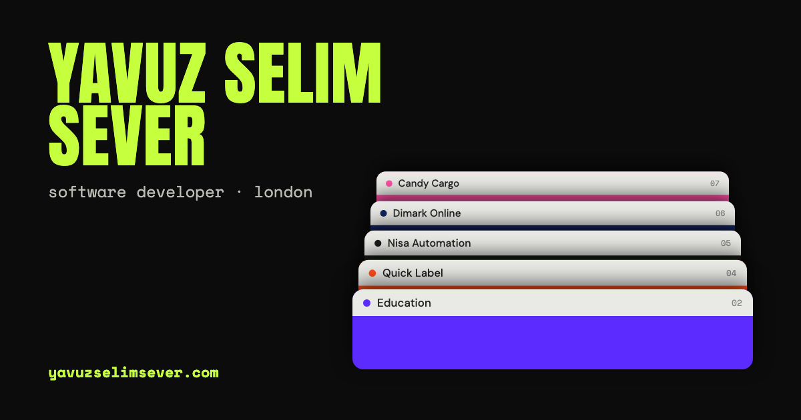

# Yavuz Selim Sever — Developer Portfolio

A responsive, interactive portfolio for presenting my engineering work, technical decisions and product-focused case studies.

[**View the live portfolio →**](https://yavuzselimsever.com)

## Overview

The site turns a conventional developer portfolio into an explorable interface. Visitors can move between stack, grid, cards and terminal views while every project remains available through its own shareable URL.

The goal is not only to show finished screens, but to explain the problems behind each project, what I built, the trade-offs I made and how the result was validated.

## Highlights

- Four navigation modes: stack, grid, playing cards and terminal
- Project case studies with dedicated deep links
- Responsive layouts covering mobile, tablet and desktop sizes
- Global project search and an Explore menu
- Keyboard-friendly navigation and focused interaction states
- Lazy-loaded 3D elements and performance-conscious animations
- Light and dark themes with saved preferences
- Vercel Analytics with route-level portfolio insights
- Unit and end-to-end coverage for core interactions

## Tech stack

| Area | Technologies |
| --- | --- |
| Frontend | React 19, TypeScript, Vite |
| Motion and 3D | GSAP, Three.js, Web Animations API |
| Testing | Vitest, Playwright |
| Quality | TypeScript project references, Oxlint |
| Hosting | Vercel |

## Engineering approach

The interface is split into focused components, hooks and style modules instead of placing the full experience in one file. Expensive visual elements render only when their view is active, while closed project cards use lightweight previews. Route changes use the History API so animations remain uninterrupted and each case study can still be shared or measured independently.

The repository includes tests for navigation, search, project opening and closing, responsive fit, card behaviour and other important user flows.

## Run locally

~~~bash
npm install
npm run dev
~~~

Open [http://localhost:5173](http://localhost:5173).

## Available commands

| Command | Purpose |
| --- | --- |
| `npm run dev` | Start the Vite development server |
| `npm run build` | Type-check and create a production build |
| `npm run lint` | Run Oxlint |
| `npm test` | Run the Vitest suite |
| `npm run test:e2e` | Run Playwright end-to-end tests |
| `npm run preview` | Preview the production build locally |

## Project structure

~~~text
src/
  components/   Reusable interface and navigation components
  hooks/        View, theme, search and interaction state
  styles/       View-specific and shared style modules
  app/          Shared application configuration
  layout/       View layout and geometry helpers
  data.ts       Portfolio and case-study content
public/         CV, social preview and static assets
tests/          Unit and browser-level tests
~~~

## Privacy

Portfolio case studies derived from professional work use recreated interfaces and fictional or anonymised data. This repository does not contain employer source code, production credentials or customer data.

## Contact

- [Portfolio](https://yavuzselimsever.com)
- [LinkedIn](https://www.linkedin.com/in/yavuz-sever-12361b190)
- [GitHub](https://github.com/Gucera)
